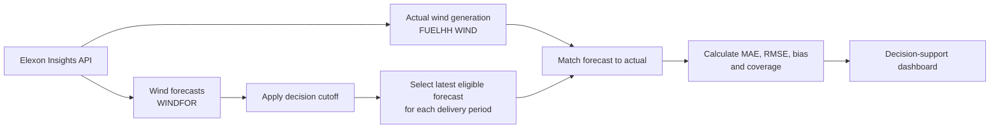

# Business Workflow Diagram

Status: this is the intended analytical workflow. The dashboard and metric calculations are **planned**, not implemented.

## Beginner-friendly explanation

The utility cannot control the weather, so it needs a weather-sensitive wind forecast before it buys electricity for the next day.

The application will take two public Elexon datasets. One dataset says what wind generation NESO expected. The other dataset says what wind generation actually happened.

The important step is not "take the newest forecast we can see today". The important step is "take the newest forecast the buyer could have seen at the time they had to decide". That is the decision cutoff.

After that fair comparison, the application will measure how large the mistakes were and whether forecasts usually overshot or undershot. Those numbers help a purchasing team decide how much they can trust the forecast.

The product does not buy electricity and does not estimate the company's full volume requirement. Customer demand and other generation sources are outside this assignment.
