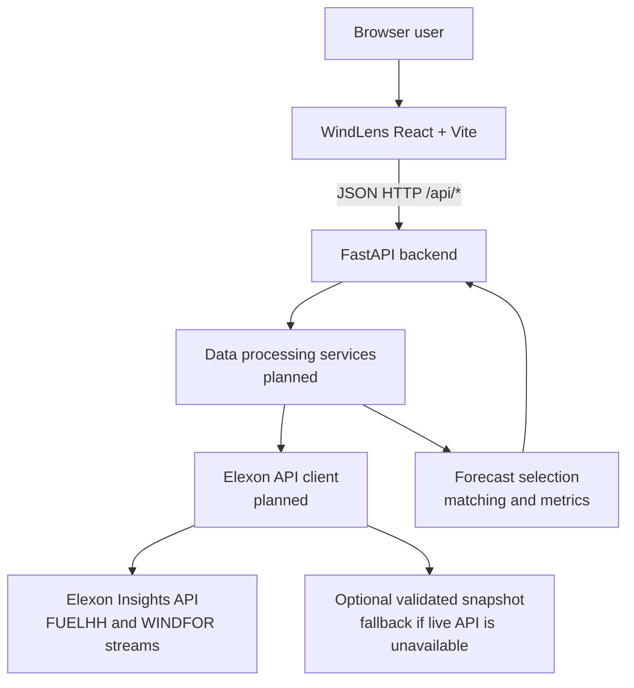

# System Architecture Diagram

Status: **implemented** for backend and WindLens frontend; deployment still planned.

## Beginner-friendly explanation

The user will open a web page. That page will not talk to Elexon directly. It will ask our backend for already-processed results.

The backend is a Python service. It will fetch or load the two Elexon datasets, clean them, choose the fair forecast for each delivery period, compare that forecast with the actual, and return charts and tables as JSON.

We are keeping the design small: no database, no login system, and no machine-learning model. If the live API is unreachable, a previously validated snapshot can be used. That snapshot must be real downloaded data, not invented numbers.
