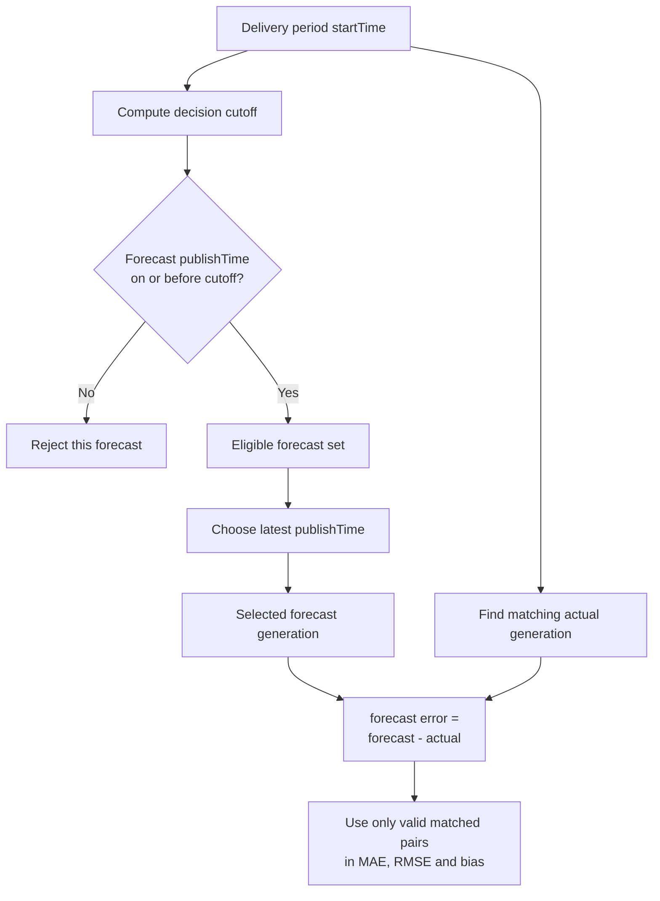

# Forecast Selection Diagram

Status: this rule is **specified** and will be unit-tested with synthetic data. It is not implemented yet.

## Beginner-friendly explanation

Imagine the buyer must place a day-ahead order at 09:20 UK time on 31 December 2025 for delivery on 1 January 2026.

Any forecast published at 10:00 that morning is useless for that historical decision, even if it later looks more accurate. The buyer could not have seen it.

So the application will:

1. Look at one delivery period.
2. Work out the cutoff time for that period.
3. Keep only forecasts published at or before that cutoff.
4. From those remaining forecasts, keep the latest one.
5. Compare that value with the actual generation.
6. Ignore any period that has no valid pair.

Three ideas must stay separate:

- the latest forecast available at the historical cutoff
- the latest forecast sitting in the dataset today
- the actual generation for the period
