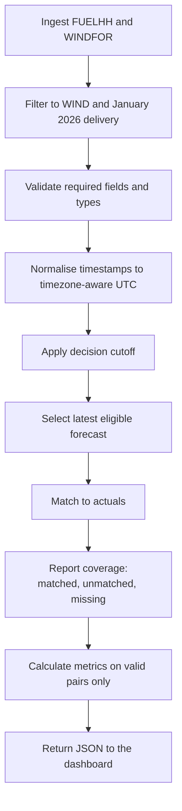

# Data Processing Flow Diagram

Status: pipeline is **planned**. The investigation step has been run.

## Beginner-friendly explanation

Data processing is a production line.

First we bring the data in. Then we keep only the national wind records for January 2026 delivery periods. Then we check that important fields are present and sensible.

Times are converted into a consistent UTC form so London daylight-saving rules can be applied later without ambiguity.

Only after that cleaning do we choose forecasts, join them to actuals, and calculate accuracy. If an actual is missing, we will report it as missing. We will not pretend the actual was zero.

The dashboard should receive both the accuracy numbers and the coverage numbers, so a reviewer can see whether the metrics are based on a complete month.
