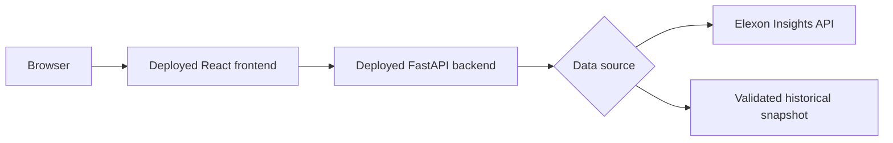

# Deployment Diagram

Status: deployment is **planned**. No public URL exists yet.

## Beginner-friendly explanation

A user will open the public website in a browser. The website is the React frontend.

That website will call the Python backend. The backend will either request Elexon data or read a validated snapshot if live access is blocked.

Local development will use Docker Compose so the same frontend/backend pairing can run on a laptop. Public hosting will be chosen in a later milestone. This report must not invent a deployment URL.
