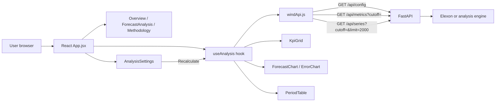

# Frontend data flow (WindLens)

Status: **implemented** in `frontend/src/`.

## Beginner-friendly explanation

The React page does not talk to Elexon directly. It asks our Python API for JSON. One hook (`useAnalysis`) loads configuration once, then loads metrics and series whenever you click **Recalculate** with a new cutoff time.

The chart and table read the same `series` array. Date filters on the chart only hide points visually; the KPI cards always reflect the full matched sample returned by `/api/metrics` for that cutoff.

## Interview-ready definition

WindLens is a React single-page application that consumes a REST JSON API, separates fetch logic in `windApi.js`, and keeps presentation in presentational components fed by hooks.
